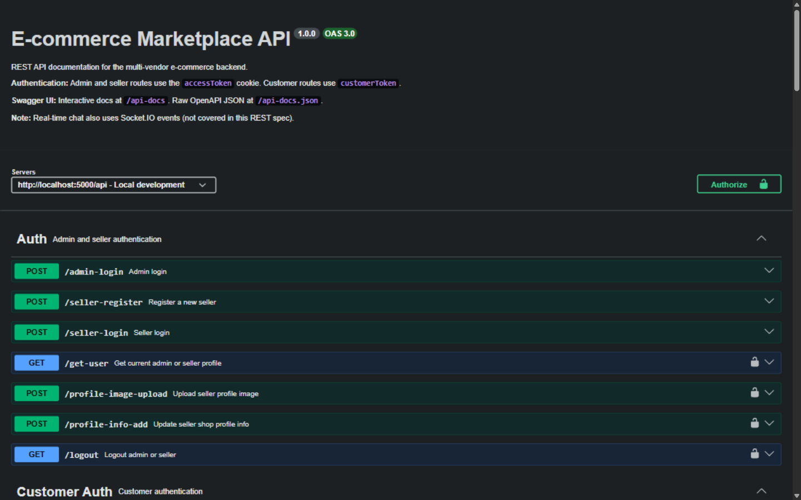

# Node.js E-Commerce API

A comprehensive **Multi-Vendor E-Commerce Backend API** built with **Node.js, Express, and MongoDB** — covering three roles (**Admin, Seller, Customer**) with JWT auth, OTP login by email, product/category/collection management, cart & wishlist, orders, sales reports, a content CMS, Stripe Connect onboarding, and real-time chat over **Socket.IO**.

> 📘 **Interactive API docs:** the full endpoint surface (~90 routes) is documented in an OpenAPI 3 spec served by Swagger UI at **[`/api-docs`](http://localhost:5000/api-docs)** once the server is running.

---

## 📸 Screenshots

| Interactive API docs — Swagger UI (`/api-docs`) |
|-------------------------------------------------|
|  |

---

## ✨ Features

### 🔐 **Authentication**
- Separate flows for **admins/sellers** and **customers** (register, login, logout)
- **OTP login** for customers via email ([Nodemailer](https://nodemailer.com/) + SMTP)
- Password reset (request/confirm)
- **JWT** (7-day expiry) delivered as an HTTP-only cookie **and** accepted as a Bearer token
- Password hashing with bcrypt

### 🛍 **Catalog (Dashboard)**
- Products CRUD + image update (Cloudinary)
- Categories CRUD
- Collections CRUD (with public storefront views)
- Seller onboarding & management (approve/deactivate sellers)

### 🏬 **Storefront (`/api/home`)**
- Public: categories, products, price-range & latest products, product query/search, product details by slug
- Customer reviews (submit/list)
- Cart & wishlist with quantity inc/dec
- Order placement, order history, and customer dashboard data

### 📊 **Dashboards & Reports**
- Admin orders + status updates
- Seller orders + status updates
- Sales reports for admin and per-seller

### 💬 **Real-time Chat (Socket.IO + REST)**
- Customer ↔ seller, seller ↔ admin, and admin ↔ customer messaging
- REST endpoints for conversation history; Socket.IO events for live delivery

### 📝 **Content CMS**
- FAQ, header, slider, contact, and recommendations — public reads + authenticated CRUD, with image uploads

### 💳 **Payments**
- Stripe integration via **Stripe Connect** account linking for sellers

---

## 🛠 Tech Stack

- [Node.js](https://nodejs.org/) + [Express 4](https://expressjs.com/) — REST API
- [MongoDB](https://www.mongodb.com/) + [Mongoose](https://mongoosejs.com/) — database
- [JSON Web Token](https://jwt.io/) + [bcrypt](https://www.npmjs.com/package/bcrypt) + [cookie-parser](https://www.npmjs.com/package/cookie-parser) — auth
- [Socket.IO 4](https://socket.io/) — real-time chat
- [Cloudinary](https://cloudinary.com/) + [formidable](https://www.npmjs.com/package/formidable) — file uploads
- [Stripe](https://stripe.com/) — seller payment onboarding (Connect)
- [Nodemailer](https://nodemailer.com/) — OTP / email delivery
- [swagger-ui-express](https://github.com/scottie1984/swagger-ui-express) — OpenAPI docs at `/api-docs`
- [Docker](https://www.docker.com/) + Docker Compose — containerization
- [moment](https://momentjs.com/) — date handling

---

## 💻 Installation

### Prerequisites
- **Node.js 20+** (the Dockerfile uses `node:20-bookworm-slim`)
- MongoDB (local or Atlas) — or just use Docker
- A [Cloudinary](https://cloudinary.com/) account (product images)
- A [Stripe](https://stripe.com/) account (seller Connect onboarding)
- An SMTP account (customer OTP emails)

### Quick Start (local)

1. **Clone the repository:**
   ```bash
   git clone https://github.com/alijamshidy/nodejs-ecommerce-api.git
   cd nodejs-ecommerce-api
   ```

2. **Install dependencies:**
   ```bash
   npm install
   ```

3. **Set up environment variables:**
   ```bash
   cp .env.example .env
   ```
   Edit `.env` (see [Environment Variables](#-environment-variables)).

4. **Seed the database (optional but recommended):**
   ```bash
   npm run seed          # insert demo data, skips non-empty collections
   # npm run seed:force  # ⚠️ drops existing collections first, then seeds
   ```

5. **Run the development server:**
   ```bash
   npm run dev
   ```

The server starts at `http://localhost:5000`, with all routes under `/api` and Swagger UI at `/api-docs`.

### Quick Start (Docker)

```bash
docker compose up --build
```

This starts three services:
- **`mongodb`** — `mongo:latest` on port 27017; mounts `./init_data` so the database auto-seeds on first volume initialization
- **`backend`** — the API on port `5000` (`DB_URL` is forced to `mongodb://mongodb:27017/myapp_db`), waits for a healthy MongoDB
- **`seed`** — one-shot `node seed/seed.js` seeding service

> With Docker Compose, seeding is automatic — `npm run seed` is only needed for non-Docker setups.

---

## ⚙ Environment Variables

All variables are in [`.env.example`](.env.example):

```env
# Server
PORT=5000

# MongoDB connection string
DB_URL=mongodb://localhost:27017/myapp_db

# JWT signing secret (tokens expire after 7 days — hardcoded in utils/tokenCreate.js)
SECRET=change_me_to_a_long_random_string

# Cloudinary (image storage) — note the lowercase names
cloud_name=your_cloudinary_cloud_name
api_key=your_cloudinary_api_key
api_secret=your_cloudinary_api_secret

# Stripe (seller Connect onboarding)
STRIPE_SECRET_KEY=sk_test_your_stripe_secret_key

# Email / OTP (SMTP)
SMTP_HOST=smtp.gmail.com
SMTP_PORT=587
SMTP_SECURE=false
SMTP_USER=your-email@gmail.com
SMTP_PASS=your-app-password
SMTP_FROM="Your Shop <your-email@gmail.com>"

# Optional — public website URL (used by payment controller)
WEBSITE_URL=http://localhost:3000
```

> ⚠️ The Cloudinary variables are **lowercase** (`cloud_name`, `api_key`, `api_secret`) — they must match exactly.
> CORS currently allows `http://localhost:3000` and `http://localhost:3001`.

---

## 📡 API Overview

Base URL: `http://localhost:5000/api` — the full, filterable list lives at **`/api-docs`** (Swagger UI). Highlights:

### Authentication
| Method | Endpoint | Description | Auth |
|--------|----------|-------------|------|
| POST | `/admin-login` | Admin login | ❌ |
| POST | `/seller-register` | Register a seller | ❌ |
| POST | `/seller-login` | Seller login | ❌ |
| GET | `/get-user` | Current user | ✅ |
| POST | `/profile-image-upload` | Upload profile image | ✅ |
| POST | `/profile-info-add` | Update profile info | ✅ |
| GET | `/logout` | Logout | ✅ |
| POST | `/customer/customer-register` | Customer registration | ❌ |
| POST | `/customer/customer-login` | Customer login | ❌ |
| POST | `/customer/send-otp` | Send OTP by email | ❌ |
| POST | `/customer/verify-otp` | Verify OTP → login | ❌ |
| POST | `/customer/reset-password-request` | Request password reset | ❌ |
| POST | `/customer/reset-password-confirm` | Confirm password reset | ❌ |

### Storefront (`/api/home/...`)
| Method | Endpoint | Description | Auth |
|--------|----------|-------------|------|
| GET | `/home/get-category` | Public categories | ❌ |
| GET | `/home/get-product` | Public products | ❌ |
| GET | `/home/query-products` | Search / filter products | ❌ |
| GET | `/home/product-details/:slug` | Product details by slug | ❌ |
| GET | `/home/collections` / `/home/collection/:slug` | Public collections | ❌ |
| POST | `/home/customer/submit-review` | Submit a product review | ✅ |
| POST | `/home/product/add-to-card` | Add to cart | ✅ |
| GET | `/home/product/get-card-products/:userId` | View cart | ✅ |
| PUT | `/home/product/quantity-inc/:card_id` / `quantity-dec/:card_id` | Change quantity | ✅ |
| POST | `/home/product/add-to-wishlist` | Add to wishlist | ✅ |
| POST | `/home/order/place-order` | Place an order | ✅ |
| GET | `/home/customer/get-orders/:customerId/:status` | Order history | ✅ |
| GET | `/home/customer/get-order-details/:orderId` | Order details | ✅ |

### Dashboard (Admin / Seller)
| Method | Endpoint | Description | Auth |
|--------|----------|-------------|------|
| POST | `/product-add` / `/product-update` / `POST /product-image-update` | Manage products | ✅ |
| DELETE | `/product-delete/:productId` | Delete product | ✅ |
| POST | `/category-add` / `GET /category-get` / … | Manage categories | ✅ |
| POST | `/collection-add` / … | Manage collections | ✅ |
| GET | `/request-seller-get` / `GET /get-sellers` | Seller management | ✅ |
| POST | `/seller-status-update` | Approve / deactivate seller | ✅ |
| GET | `/admin-orders` / `GET /admin/order/:orderId` | Admin orders | ✅ |
| PUT | `/admin/order-status/update/:orderId` | Update order status | ✅ |
| GET | `/seller/orders/:sellerId` | Seller's orders | ✅ |
| GET | `/admin/sales-report` / `GET /seller/sales-report/:sellerId` | Sales reports | ✅ |

### Chat (`/api/chat/...`) & Content (`/api/content/...`)
- **Chat:** customer/seller/admin conversation endpoints (`/chat/customer/add-customer-friend`, `/chat/seller/get-customers/:sellerId`, `/chat/message-send-seller-admin`, …) plus Socket.IO events (`add_user`, `send_seller_message`, `send_customer_message`, …)
- **Content CMS:** public reads at `/faq`, `/header`, `/slider`, `/contact`, `/recommendations` (also under `/home/`), and authenticated CRUD under `/content/faq`, `/content/header`, `/content/slider`, `/content/contact`, `/content/recommendation`

### Payments
| Method | Endpoint | Description | Auth |
|--------|----------|-------------|------|
| GET | `/payment/create-stripe-connect-account` | Stripe Connect account linking for sellers | ✅ |

> ℹ️ Auth tokens are sent either via the HTTP-only cookie (set at login) or an `Authorization: Bearer <token>` header.

---

## 🧪 Seeded Test Accounts

After seeding (`npm run seed` / Docker auto-seed):

| Role | Email | Password |
|------|-------|----------|
| Admin | `a@admin.com` | `123456` |
| Seller | `seller1@test.com`, `seller2@test.com`, … | `123456` |
| Customer | `customer1@test.com`, `customer2@test.com`, … | `123456` |

> ⚠️ Demo credentials only — never use them in production.

---

## 📁 Folder Structure

```
nodejs-ecommerce-api/
├── server.js               # Express app + Socket.IO bootstrap
├── controllers/            # auth, chat/, content/, dashboard/, home/, order/, payment/
├── models/                 # Mongoose schemas (Chat/, content/, ...)
├── routes/                 # 13 route files (auth, content/, dashboard/, home/, order/, payment/)
├── middlewares/            # authMiddleware (JWT verification, sets req.role)
├── utils/                  # tokenCreate, cloudinary, sendEmail, ...
├── seed/                   # seed.js (+ --force flag), generate-init.js
├── init_data/              # Initial seed data (auto-mounted in Docker)
├── docs/                   # swagger.js + openapi/ (OpenAPI 3 spec)
├── Dockerfile
├── docker-compose.yml
└── .env.example
```

---

## 📦 Available Scripts

| Script | Description |
|--------|-------------|
| `npm run dev` | Start dev server with nodemon |
| `npm start` | Start production server (`node server.js`) |
| `npm run seed` | Seed database (insert-only, skips non-empty collections) |
| `npm run seed:force` | ⚠️ Drop all collections, then seed from scratch |
| `npm run seed:generate` | Regenerate `seed/init.js` from `seed/build-data.js` |

---

## 🤝 Contributing

Contributions are welcome! Please follow these steps:

1. Fork the repository
2. Create your feature branch (`git checkout -b feature/AmazingFeature`)
3. Commit your changes (`git commit -m 'Add some AmazingFeature'`)
4. Push to the branch (`git push origin feature/AmazingFeature`)
5. Open a Pull Request

---

## 📜 License

This project is **private** and all rights are reserved.

---

## 🆘 Support

For support, please open an issue or contact the maintainer.

---

## 🏷 Topics

`nodejs`, `express`, `mongodb`, `mongoose`, `ecommerce`, `multi-vendor`, `api`, `rest-api`, `jwt-authentication`, `socket-io`, `stripe`, `cloudinary`, `swagger`, `docker`, `backend`
